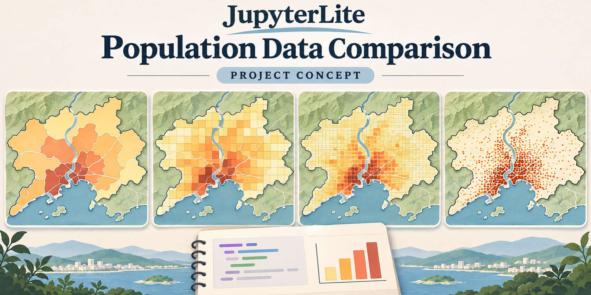

# JupyterLite-Population-Data-Comparison

**[Read the Book](https://jltobias.github.io/JupyterLite-Population-Data-Comparison/book/intro.html) | [Open JupyterLite Lab](https://jltobias.github.io/JupyterLite-Population-Data-Comparison/lab/lab/index.html?path=01_real_population.ipynb) | [Launch Population-Data-Comparison-Viewer](https://jltobias.github.io/JupyterLite-Population-Data-Comparison/viewer/index.html)**



*The splash is an original AI-generated concept illustration with invented geography and illustrative marks. It is not a screenshot, a population dataset, or an analytical result. Generation details are recorded in [assets/README.md](assets/README.md).*

Compare real population products in four linked maps, inspect native pixels, and reproduce area totals in browser Python. Inspired by the POPGRID Viewer workflow and the research and stewardship of NASA, SEDAC/CIESIN and the POPGRID Data Collaborative. This is an independent project. [Leyk et al. (2019)](https://doi.org/10.5194/essd-11-1385-2019) explain why fitness for use matters more than nominal cell size.

The default viewer uses genuine **native-pixel Greater Lagos excerpts**, with source values and NoData retained without resampling. Prepared extent: `[3.2, 6.35, 3.6, 6.7]` (W,S,E,N); edge cells follow native grid boundaries. The ready-to-use Lagos comparison loads bounded native windows from a lightweight catalog; viewer startup never downloads the full count JSON. The four prepared products cover this region. Compatible public HTTPS or local count TIFFs can supply other supported areas. Explicit synthetic fixtures remain for tests and small GeoJSON lessons only; failures show errors and never substitute them.

| Bundled product | Release and reference | Concept and important limits |
| --- | --- | --- |
| WorldPop Global2 2025 | R2025A v1 alpha, January 1, 2025, native ~100 m | Residential estimate; constrained Random Forest allocation; NoData -99999. |
| GRID3 Nigeria 2025 | v3.0, scaled to July 2025, native ~100 m | Residential model; NaN means mapped unsettled inside Nigeria or outside national coverage. Operational estimates, not official government statistics. |
| LandScan Global 2020 | 2020, native 30 arcseconds | Ambient 24-hour average. Pinned Hugging Face mirror, independently checked against ORNL statistics for this window; full-file bit identity not established. |
| GHS-POP 2025 | R2023A E2025 WGS84 30ss V1.0 | Residential projection using GPWv4.11 demographic inputs and GHSL built-up information. Official JRC pixels, distinct grid offset; zeros, including water, are valid. |

All four excerpts are **CC BY 4.0** with complete source citations, attribution parties, notices, exact asset identities, retrieval dates, native geometry, hashes and processing receipts in [the data record](data/README.md), [canonical metadata](data/population.json) and [preparation receipts](data/real/preparation.json). Spatial subsetting/serialization is disclosed; no producer endorsement is implied. The project MIT license does not relicense source data or vendor software.

Recommended citations for the releases actually used:

- **WorldPop Global2:** Bondarenko M., Priyatikanto R., Tejedor-Garavito N., Zhang W., McKeen T., Cunningham A., Woods T., Hilton J., Cihan D., Nosatiuk B., Brinkhoff T., Tatem A., Sorichetta A. (2025). *Estimates of 2015–2030 total number of people per grid square at a resolution of 3 arc (approximately 100 m at the equator), R2025A version v1.* Global Demographic Data Project, WorldPop, School of Geography and Environmental Science, University of Southampton. Funded by the Bill and Melinda Gates Foundation, INV-045237. [DOI: 10.5258/SOTON/WP00839](https://doi.org/10.5258/SOTON/WP00839). Selected asset: Nigeria 2025 constrained 100 m, alpha public release.
- **GRID3 Nigeria:** Nnanatu C.C., Gadiaga A., Abbott T.J., Chamberlain H., Lazar A.N., Tatem A.J. (2025). *Modelled gridded population estimates for Nigeria 2025 version 3.0.* WorldPop, University of Southampton. [DOI: 10.5258/SOTON/WP00782](https://doi.org/10.5258/SOTON/WP00782). Credit GRID3 Inc., WorldPop, CIESIN / Columbia Climate School and Gates Foundation INV-044979. Operational estimates, not official government statistics; no warranties.
- **LandScan Global 2020:** Rose A., McKee J., Sims K., Bright E., Reith A., Urban M. (2021). *LandScan Global 2020.* Oak Ridge National Laboratory. [DOI: 10.48690/1523378](https://doi.org/10.48690/1523378), [producer licensing](https://landscan.ornl.gov/licensing). Preserve the pinned-mirror identity and limited independent ORNL validation described in the data record.
- **GHS-POP:** Schiavina M., Freire S., Carioli A., MacManus K. (2023). *GHS-POP R2023A — GHS population grid multitemporal (1975–2030).* European Commission/JRC. [DOI: 10.2905/2FF68A52-5B5B-4A22-8F40-C41DA8332CFE](https://doi.org/10.2905/2FF68A52-5B5B-4A22-8F40-C41DA8332CFE). Selected E2025 WGS84 30ss V1.0. Also cite **Pesaresi et al. (2024)**, [DOI: 10.1080/17538947.2024.2390454](https://doi.org/10.1080/17538947.2024.2390454); full dataset/publication entries remain below. Retain `(c) European Union, 1995-2026`, CC BY 4.0 and the modification/no-endorsement statement.

The shared analysis rectangle `[3.30, 6.45, 3.45, 6.60]` gives approximately **3,058,259.42; 2,375,656.06; 7,422,967.00; and 5,013,773.99** people, respectively. Numeric-cell coverage differs. These are spherical overlap-weighted estimates, with uniform population assumed inside each cell. Reference dates, concepts and source census vintages differ. WorldPop and GRID3 share producers/inputs; GHS-POP uses GPW inputs. Agreement is not independent validation and disagreement is not accuracy evidence.

The viewer supports synchronized or independent navigation, a shared density display scale (people/km²), click and keyboard coordinate inspection of native counts, typed/drawn/use-map study bounds, staged loading with estimates, progress, cancel and a bounded reusable-window cache, and CSV/JSON/SVG exports with full provenance, grid identity, bounds, coverage and method. All four maps use **five shared area-weighted modified quantile classes** with the [ColorBrewer YlOrBr palette](https://colorbrewer2.org/#type=sequential&scheme=YlOrBr&n=5). The pooled positive-density 20th/40th/60th/80th percentiles weight native cells by their area inside committed study bounds; repeated panel selections do not duplicate a source. Fine grids therefore do not dominate by pixel count. Tied values stay together; zero is separately gray and NoData transparent. Breaks and legends update together after a successful comparison or layer change and accompany exported provenance. Areas outside prepared coverage are explicit. Charts and exports preserve source rights and modification notices. See [the classification method](book/methods.md#shared-modified-quantile-colors) for ties, empty areas and comparison between study bounds.

Choose study bounds before loading. Orange dashed rectangles are drafts; blue rectangles and exports retain the last successful comparison until all four native windows and display images pass validation. Plans report cells, output count memory, selected compressed blocks and decoded block memory. Full-width TIFF strips can cost the same network bytes after west/east narrowing; actual transfer also includes headers and repeated metadata. Same-asset/hash snapped windows reuse bounded session counts while recalculating exact-box totals. "Compare already loaded windows" explicitly recalculates existing support without fetching more pixels.

For other areas, select a public **HTTPS** or local **single-band, little-endian, north-up EPSG:4326 count GeoTIFF**, review its metadata declaration, and copy the current study bounds. Plan headers first, then read the native window. A successful import commits its chosen comparison bounds with the native image and values. The editable LandScan Global 2020 pinned-mirror template supports remote windows; its lineage is user-declared and copied Lagos verification claims are removed. This does not imply remote access to all four products. No file is uploaded and no server performs analysis. The companion [JupyterLite-STAC-Browser](https://github.com/jltobias/JupyterLite-STAC-Browser) inspired bbox-first acquisition and its MIT bounded Range reader; the pinned code credit is in [the reader notices](viewer/vendor/geotiff/README.md).

Remote origins must return exact HTTP 206 ranges and expose Content-Range plus a strong ETag or Last-Modified through CORS. Last-Modified has weaker, second-level identity precision. HTTP 200 ignored-Range bodies are rejected without consumption; changed, malformed or truncated ranges fail. There is no full-file fallback, resampling, proxy or TLS bypass. Acquisition receipts preserve stable source URLs, request/actual byte counts and native windows; partial reads never verify a full-file SHA. Signed query URLs and credentials are rejected. Local files retain the 2 GiB file limit; remote assets may be larger if bounded work fits the limits. See [the import contract](book/methods.md) for metadata, request, memory and timeout limits. Small rectangular-cell GeoJSON remains limited to 2 MB / 2,000 nonoverlapping cells.

WorldPop and GRID3 file downloads currently lack browser CORS and ignore Range requests; their metadata access does not imply numerical browser access. Local files and prepared same-origin excerpts solve this without proxies or TLS bypass. **No GPW pixels are bundled**: present Harvard Dataverse access uses a guestbook, and this project does not collect or submit personal details. GHS-POP is the additional open product. HRSL and Esri WPE remain historical candidates. STAC Index is a discovery directory, not a data producer or proof of numerical access.

Book and Lab use the same canonical real arrays and helper. Launch names `01_real_population.ipynb`, `02_real_coverage.ipynb`, `03_real_exports.ipynb` and helper alias `population_tools_real.py` avoid shadowing older synthetic files in returning users' browser storage. Existing user notebooks are preserved. Lab's first kernel start retrieves pinned Pyodide runtime packages; population services are not queried. Download generated files from `outputs` to keep them.

Install the pinned standard build dependencies, then verify:

```powershell
python -m pip install -r requirements.txt
python scripts/create_population_catalog.py --check
python -m unittest discover -s tests -v
python scripts/build_site.py
python scripts/check_browser.py
```

Source preparation is an **explicit separate operation**, never part of ordinary builds:

```powershell
python -m pip install -r requirements-raster.txt
python scripts/prepare_population.py --retrieval-date 2026-11-06
# For missing source inputs only, explicitly allow verified HTTPS acquisition:
python scripts/prepare_population.py --download --retrieval-date 2026-11-06
```

The date above is the known acquisition date of the preserved original inputs. For other manually supplied inputs, declare their actual retrieval date; existing acquisition receipts take precedence.

Explicit preparation also stages the deterministic, value-free `data/population-catalog.json` from canonical geometry and TIFF sizes/hashes/block tables, using a standard-library generator. Normal builds copy the checked-in catalog without refreshing sources. Canonical notebook arrays and original TIFF bytes/receipts remain unchanged.

The ignored `.cache/population/` preserves acquisition inputs independently of build cleanup. The publication builder uses an explicit allowlist and records hashes in `_site/publication.json`; it never publishes cache, development tools, machine settings or credentials. Independent rasterio/NumPy source expectations are preserved in [the oracle](data/real/independent_oracle.json). Tests cover native source values, masks, boundary fractions, rejected inputs, actual TIFF imports/exports, mobile layout and all three real Pyodide lessons.

Full GIS, polygon/district summaries, native RustGIS in Pyodide, GeoLibre/JupyterGIS handoffs and a FieldWork widget remain future integration work. Related projects: [JupyterLite-GeoLibre-GeoAI](https://github.com/jltobias/JupyterLite-GeoLibre-GeoAI), [JupyterLite-RustGIS](https://github.com/jltobias/JupyterLite-RustGIS), [JupyterLite-STAC-Browser](https://github.com/jltobias/JupyterLite-STAC-Browser) and [FieldWork](https://digital-twin-ph.github.io/fieldwork/).

## References and credits

The historical research and source inventory below remains useful background. The actual bundled releases and their citations are recorded above and in `data/README.md`; older unselected assets are not bundled.


### POPGRID research, viewer, and institutional work

1. **Leyk, S., Gaughan, A. E., Adamo, S. B., de Sherbinin, A., Balk, D., Freire, S., Rose, A., Stevens, F. R., Blankespoor, B., Frye, C., Comenetz, J., Sorichetta, A., MacManus, K., Pistolesi, L., Levy, M., Tatem, A. J., and Pesaresi, M. (2019).** *The spatial allocation of population: a review of large-scale gridded population data products and their fitness for use.* Earth System Science Data, **11**, 1385–1409. [DOI: 10.5194/essd-11-1385-2019](https://doi.org/10.5194/essd-11-1385-2019).
2. **Smith, Joseph M. (2023, October 31).** *Data Tool in Focus: POPGRID Viewer.* NASA Earthdata. [Feature article](https://www.earthdata.nasa.gov/news/feature-articles/data-tool-focus-popgrid-viewer) · [Earlier article URL](https://www.earthdata.nasa.gov/learn/articles/popgrid-viewer-sedac). Documents the viewer's comparison workflows and the work of SEDAC, CIESIN, and POPGRID.
3. **NASA Earthdata / SEDAC (2020, July 3).** *SEDAC Updates Global COVID-19 Viewer and POPGRID Viewer.* [NASA announcement](https://www.earthdata.nasa.gov/news/sedac-updates-global-covid-19-viewer-popgrid-viewer).
4. **CIESIN / SEDAC (2022, July 27).** *POPGRID Viewer tool.* GEO Knowledge Hub, Earth Observations Toolkit for Sustainable Cities and Human Settlements. [Tool record](https://gkhub.earthobservations.org/records/5ar2q-as677).
5. **POPGRID Data Collaborative.** [Collaborative website](https://www.popgrid.org/) · [Dataset comparison resources](https://www.popgrid.org/compare-data). Credit the collaborative and each original producer when using its resources.
6. **SEDAC / CIESIN.** *POPGRID Viewer*, [historical application endpoint](https://sedac.ciesin.columbia.edu/mapping/popgrid/). For service history, see the [NASA Earthdata Forum response dated September 22, 2025](https://forum.earthdata.nasa.gov/viewtopic.php?t=7126), which reports SEDAC's contract termination, relocation of datasets, and the unresolved viewer link. Dataset relocation does not establish viewer availability.
7. **CIESIN / SEDAC (2022, July 27).** *POPGRID Viewer.* GEO Knowledge Hub knowledge package. [DOI: 10.60566/xxb7r-60d58](https://doi.org/10.60566/xxb7r-60d58) · [Package and historical six-dataset list](https://gkhub.earthobservations.org/packages/xxb7r-60d58).
8. **WorldPop Project.** *Methods.* [Producer methods guide](https://www.worldpop.org/methods/). For the random-forest method, see **Stevens, F. R., Gaughan, A. E., Linard, C., and Tatem, A. J. (2015).** *Disaggregating Census Data for Population Mapping Using Random Forests with Remotely-Sensed and Ancillary Data.* PLOS ONE, **10**(2), e0107042. [DOI: 10.1371/journal.pone.0107042](https://doi.org/10.1371/journal.pone.0107042).
9. **Schiavina, M., Freire, S., Carioli, A., and MacManus, K. (2023).** *GHS-POP R2023A — GHS population grid multitemporal (1975–2030).* European Commission, Joint Research Centre. [Producer documentation](https://human-settlement.emergency.copernicus.eu/ghs_pop2023.php) · [DOI: 10.2905/2FF68A52-5B5B-4A22-8F40-C41DA8332CFE](https://doi.org/10.2905/2FF68A52-5B5B-4A22-8F40-C41DA8332CFE). An example of a later release, rather than a claim about the historical viewer's version.
10. **Pesaresi, M., Schiavina, M., Politis, P., Freire, S., et al. (2024).** *Advances on the Global Human Settlement Layer by joint assessment of Earth Observation and Population Survey data.* International Journal of Digital Earth, **17**(1). [DOI: 10.1080/17538947.2024.2390454](https://doi.org/10.1080/17538947.2024.2390454) · [JRC publication record and full author list](https://publications.jrc.ec.europa.eu/repository/handle/JRC136539). The current [GHSL use/citation instructions](https://human-settlement.emergency.copernicus.eu/GHSLhowToCite.php) request this release publication along with applicable product citations.

### Data citation and license records

These records preserve historical source research and provider guidance. The active WorldPop, GRID3, LandScan and GHS-POP releases are cited above; GPW, HRSL, Esri WPE and other unselected historical assets are not bundled:

- **CIESIN–Columbia University (2017).** *Gridded Population of the World, Version 4 (GPWv4): Population Count, Revision 10.* NASA Socioeconomic Data and Applications Center (SEDAC), Palisades, NY. [DOI: 10.7927/H4PG1PPM](https://doi.org/10.7927/H4PG1PPM). This identifier is for the historical count product, not every GPW variant; [NASA's directory](https://cmr.earthdata.nasa.gov/search/site/collections/directory/ESDIS/gov.nasa.eosdis) lists the variants separately. No retrieval date for a data file is claimed.
- **ORNL:** [LandScan archive description](https://www.ornl.gov/project/geospatial-data-sets) and [LandScan distribution portal](https://landscan.ornl.gov/). The selected 2020 release's recommended citation, CC BY 4.0 license, mirror identity and independent regional validation receipts are recorded above and in the data record; other annual releases remain unselected.
- **WorldPop:** [FAQ: citation and redistribution guidance](https://www.worldpop.org/faq/) and [methods guide](https://www.worldpop.org/methods/). The specific 2014 country/product asset remains unselected. **WorldPop and Institut National de la Statistique du Mali (2022),** *Census-cartography-based gridded population estimates for Mali (2020), version 1.0*, [DOI: 10.5258/SOTON/WP00745](https://doi.org/10.5258/SOTON/WP00745), is cited here only as an example whose [release statement](https://data.worldpop.org/repo/wopr/MLI/population/v1.0/MLI_population_v1_0_README.pdf) specifies CC BY-SA 4.0.
- **European Commission/JRC:** [GHSL use conditions and citation instructions](https://human-settlement.emergency.copernicus.eu/GHSLhowToCite.php), with the versioned dataset and publication references above.
- **Esri:** *2016 World Population Estimate Methodology*, [technical paper](https://www.esri.com/content/dam/esrisites/en-us/media/technical-papers/2016-world-population-estimate-methodology.pdf), and [data attributions and terms](https://www.esri.com/en-us/legal/terms/data-attributions). An exact count/density service item and its dataset citation/use terms remain to be verified.
- **Meta and CIESIN–Columbia University (2022).** *High Resolution Settlement Layer (HRSL).* [Meta-managed distribution record, recommended citation, and CC BY 4.0 notice](https://registry.opendata.aws/dataforgood-fb-hrsl/). That record also credits the source imagery to Maxar with a 2016 copyright notice. This is a later distribution record, not a substitute citation for the unselected 2015 historical asset; add the real file-access date when data are retrieved.
- **Creative Commons:** [CC BY 4.0 attribution conditions](https://creativecommons.org/licenses/by/4.0/) and [CC BY-SA 4.0 conditions](https://creativecommons.org/licenses/by-sa/4.0/).

### Software and related work

- **Project Jupyter and contributors:** [JupyterLite](https://jupyterlite.readthedocs.io/en/stable/) and [JupyterGIS / GeoJupyter](https://jupytergis.readthedocs.io/en/latest/).
- **Pyodide contributors:** [Pyodide documentation](https://pyodide.org/en/stable/) and [source](https://github.com/pyodide/pyodide), the browser Python runtime used by the teaching notebooks.
- **Jupyter Book and MyST contributors:** [Jupyter Book documentation](https://jupyterbook.org/stable/).
- **Wu, Q. (2026).** *GeoLibre.* [DOI: 10.5281/zenodo.20785400](https://doi.org/10.5281/zenodo.20785400) · [upstream recommended citation](https://github.com/opengeos/GeoLibre/blob/main/CITATION.cff). The citation file identifies MIT licensing; cite the version actually used when integrated.
- **Wu, Q., Rincón Albarracín, J. G., Filho, E., Hofbauer, D., Fitzgerald, M., and Strebel, D. (2026).** *RustGIS: A fast, free and open-source GIS in pure Rust for mapping, analyzing and sharing geospatial data.* [DOI: 10.5281/zenodo.23633281](https://doi.org/10.5281/zenodo.23633281) · [upstream recommended citation](https://github.com/opengeos/RustGIS/blob/main/CITATION.cff). The citation file identifies Apache-2.0 licensing; cite the version actually used when integrated.
- **James L. Tobias / jltobias:** [JupyterLite-GeoLibre-GeoAI](https://github.com/jltobias/JupyterLite-GeoLibre-GeoAI) and [JupyterLite-RustGIS](https://github.com/jltobias/JupyterLite-RustGIS), companion workflow and teaching references.
- **digital-twin-ph and FieldWork contributors:** [FieldWork application](https://digital-twin-ph.github.io/fieldwork/) and [source repository](https://github.com/digital-twin-ph/fieldwork), the proposed host integration.

Notebooks and exports cite the particular population datasets and software versions they use; future boundaries and basemaps will need their own source records. Those materials retain their own licenses and attribution requirements. When incorporating upstream code, distributions, or artwork, preserve the relevant license files and notices in addition to these scholarly acknowledgments.
